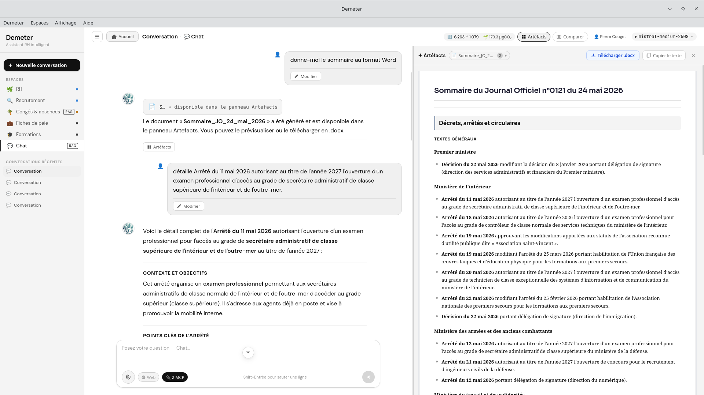

# mcp-legifrance

[](LICENSE)
[](https://www.python.org/)
[](https://modelcontextprotocol.io/)
[](https://www.docker.com/)
[](https://piste.gouv.fr)

---

`mcp-legifrance` expose l'intégralité de l'**API Légifrance** (PISTE / DILA) sous forme de serveur [MCP](https://modelcontextprotocol.io/) HTTP Streamable. Il donne à n'importe quel LLM compatible MCP un accès direct au droit français — codes, lois, décrets, Journal Officiel, conventions collectives, jurisprudence, circulaires, délibérations CNIL, dossiers et débats parlementaires.

Avec **62 outils**, c'est la couverture la plus complète de l'API Légifrance disponible en MCP : consultation de codes article par article, navigation dans l'historique des versions, recherche plein texte tous fonds, export des bulletins BOCC/BODMR, accès aux accords d'entreprise et bien plus. Compatible Claude Desktop, Claude Code, Demeter ou toute application Tauri/Electron.

Il partage ses identifiants PISTE avec `mcp-judilibre` et peut tourner simultanément sur le même hôte.

---

## Aperçu



---

## Prérequis

- Python 3.11+
- Un compte sur [piste.gouv.fr](https://piste.gouv.fr) avec accès à l'API Légifrance (gratuit)

> **Note :** Si vous utilisez déjà `mcp-judilibre`, les identifiants PISTE sont les mêmes. Il suffit d'ajouter la souscription à l'API Légifrance dans votre application PISTE existante.

---

## Obtenir les identifiants API Légifrance

L'API Légifrance est exposée via la plateforme **PISTE** (Plateforme d'Intermédiation des Services pour la Transformation de l'État), gérée par la DILA.

### 1. Créer un compte PISTE

Rendez-vous sur [https://piste.gouv.fr](https://piste.gouv.fr) et cliquez sur **S'inscrire**. L'inscription est gratuite et ouverte à tous (particuliers, entreprises, collectivités).

### 2. Créer une application (ou réutiliser l'existante)

Une fois connecté :

1. Allez dans **Mes applications** → **Nouvelle application** (ou ouvrez votre application existante)
2. Donnez un nom à votre application (ex: `mcp-legifrance`)
3. Sélectionnez l'**environnement Sandbox** pour commencer (accès immédiat, données réelles en lecture seule)

### 3. Souscrire à l'API Légifrance

1. Dans le catalogue, recherchez **Légifrance**
2. Cliquez sur **Souscrire** → choisissez votre application
3. La souscription est automatiquement approuvée pour l'environnement Sandbox

### 4. Récupérer les identifiants

Dans votre application PISTE, copiez :
- **Client ID** (`LEGIFRANCE_CLIENT_ID`)
- **Client Secret** (`LEGIFRANCE_CLIENT_SECRET`)

> **Note :** L'environnement Sandbox et l'environnement Production utilisent les mêmes données. La différence porte uniquement sur les quotas. Pour un usage intensif, faites une demande d'accès Production depuis PISTE.

---

## Installation

### Installation locale (Python)

```bash
git clone https://github.com/ktulu-analog/mcp-legifrance.git
cd mcp-legifrance
python -m venv .venv
source .venv/bin/activate   # Windows : .venv\Scripts\activate
pip install -r requirements.txt
```

### Installation via Docker

```bash
git clone https://github.com/ktulu-analog/mcp-legifrance.git
cd mcp-legifrance
docker build -t mcp-legifrance .
```

---

## Configuration

Copiez `.env.example` en `.env` et renseignez vos identifiants :

```bash
cp .env.example .env
```

```env
LEGIFRANCE_CLIENT_ID=votre_client_id
LEGIFRANCE_CLIENT_SECRET=votre_client_secret
```

Ou exportez-les directement dans votre shell :

```bash
export LEGIFRANCE_CLIENT_ID=votre_client_id
export LEGIFRANCE_CLIENT_SECRET=votre_client_secret
```

---

## Démarrage

### En local (Python)

```bash
python server.py
```

Options disponibles :

```
--host   Adresse d'écoute  (défaut : 0.0.0.0)
--port   Port d'écoute     (défaut : 6502)
--path   Chemin MCP        (défaut : /mcp)
```

Exemple sur un port personnalisé :

```bash
python server.py --port 8080
```

### Via Docker

```bash
docker run -p 6502:6502 \
  -e LEGIFRANCE_CLIENT_ID=votre_client_id \
  -e LEGIFRANCE_CLIENT_SECRET=votre_client_secret \
  mcp-legifrance
```

Le serveur peut tourner sur n'importe quelle machine accessible en réseau. Les clients MCP se connectent alors à `http://adresse-du-serveur:6502/mcp` — le serveur n'a pas besoin d'être sur la même machine que le client.

Le serveur est accessible à `http://localhost:6502/mcp`.

---

## Intégration avec un client MCP

### Claude Desktop

Dans `claude_desktop_config.json` :

```json
{
  "mcpServers": {
    "legifrance": {
      "url": "http://localhost:6502/mcp"
    }
  }
}
```

Pour utiliser les deux serveurs simultanément avec `mcp-judilibre` :

```json
{
  "mcpServers": {
    "legifrance": {
      "url": "http://localhost:6502/mcp"
    },
    "judilibre": {
      "url": "http://localhost:6501/mcp"
    }
  }
}
```

### Claude Code

```bash
claude mcp add legifrance --url http://localhost:6502/mcp
```

### Autre client HTTP Streamable

Tout client supportant la spec MCP 2025-03-26 HTTP Streamable peut se connecter à `http://localhost:6502/mcp`.

---

## Outils disponibles

### Journal Officiel (JORF)
| Outil | Description |
|---|---|
| `legifrance_derniers_jo` | Derniers numéros du JO parus |
| `legifrance_sommaire_jorf` | Sommaire d'un JO par date ou identifiant |
| `legifrance_jorf` | Contenu complet d'un texte du JO (par CID) |
| `legifrance_jorf_part` | Contenu d'une section d'un texte du JO |
| `legifrance_jo_par_nor` | Texte du JO par numéro NOR |
| `legifrance_eli_alias_texte` | Texte du JO par identifiant ELI ou alias |
| `legifrance_dates_sans_jo` | Dates sans parution du JO |

### Codes législatifs (LEGI)
| Outil | Description |
|---|---|
| `legifrance_lister_codes` | Liste de tous les codes disponibles |
| `legifrance_consulter_code` | Table des matières d'un code |
| `legifrance_code_complet` | Contenu complet d'un code |
| `legifrance_code_par_ancien_id` | Code par ancien identifiant |
| `legifrance_obtenir_article` | Contenu d'un article par identifiant |
| `legifrance_article_par_numero` | Article par numéro dans un code |
| `legifrance_article_par_eli` | Article par identifiant ELI |
| `legifrance_versions_article` | Historique des versions d'un article |
| `legifrance_articles_meme_numero` | Tous les articles portant le même numéro |
| `legifrance_loi_decret` | Texte de loi ou décret par identifiant |
| `legifrance_legi_part` | Section d'un texte LEGI |
| `legifrance_tables_annuelles` | Tables annuelles LEGI |
| `legifrance_annees_sans_table` | Années sans table annuelle |
| `legifrance_historique_texte` | Historique complet d'un texte |
| `legifrance_versions_element` | Versions d'un élément de texte |
| `legifrance_a_des_versions` | Vérifie si un texte a des versions |
| `legifrance_version_canonique_article` | Version canonique d'un article |
| `legifrance_version_canonique` | Version canonique d'un texte |
| `legifrance_version_proche` | Version la plus proche d'une date |

### Lois et décrets (LODA)
| Outil | Description |
|---|---|
| `legifrance_lister_loda` | Liste paginée des textes LODA |
| `legifrance_liens_concordance` | Liens de concordance d'un texte |
| `legifrance_liens_relatifs` | Liens relatifs d'un texte |
| `legifrance_liens_service_public` | Liens Service-Public.fr |
| `legifrance_a_liens_service_public` | Vérifie l'existence de liens Service-Public |

### Conventions collectives (KALI)
| Outil | Description |
|---|---|
| `legifrance_conventions` | Liste des conventions collectives |
| `legifrance_convention_par_idcc` | Convention par numéro IDCC |
| `legifrance_convention_cont` | Conteneur d'une convention |
| `legifrance_convention_texte` | Texte d'une convention |
| `legifrance_convention_article` | Article d'une convention |
| `legifrance_convention_section` | Section d'une convention |

### Jurisprudence (CASS, CETAT, CONSTIT, JURITEXT…)
| Outil | Description |
|---|---|
| `legifrance_jurisprudence` | Décision de justice par identifiant |
| `legifrance_jurisprudence_plan_classement` | Plan de classement jurisprudentiel |
| `legifrance_jurisprudence_ancien_id` | Décision par ancien identifiant |

### Dossiers et débats parlementaires
| Outil | Description |
|---|---|
| `legifrance_dossier_legislatif` | Dossier législatif par identifiant |
| `legifrance_debat` | Débat parlementaire par identifiant |
| `legifrance_lister_legislatures` | Liste des législatures |
| `legifrance_lister_dossiers_legislatifs` | Dossiers législatifs paginés |
| `legifrance_lister_debats_parlementaires` | Débats parlementaires paginés |
| `legifrance_lister_questions_parlementaires` | Questions parlementaires paginées |
| `legifrance_section_par_cid` | Section par CID |

### Documents administratifs (CIRC, ACCO, CNIL, BOCC…)
| Outil | Description |
|---|---|
| `legifrance_circulaire` | Circulaire par identifiant |
| `legifrance_acco` | Accord d'entreprise par identifiant |
| `legifrance_cnil` | Délibération CNIL par identifiant |
| `legifrance_cnil_ancien_id` | Délibération CNIL par ancien identifiant |
| `legifrance_lister_bocc` | Bulletins BOCC paginés |
| `legifrance_lister_bocc_textes` | Textes d'un bulletin BOCC |
| `legifrance_lister_boccs_et_textes` | Bulletins et textes BOCC combinés |
| `legifrance_bocc_pdf_metadata` | Métadonnées PDF d'un bulletin BOCC |
| `legifrance_lister_docs_admins` | Documents administratifs paginés |
| `legifrance_lister_bodmr` | Bulletins BODMR paginés |

### Recherche et utilitaires
| Outil | Description |
|---|---|
| `legifrance_rechercher` | Recherche plein texte tous fonds |
| `legifrance_suggerer` | Suggestions de textes |
| `legifrance_suggerer_acco` | Suggestions d'accords |
| `legifrance_suggerer_pdc` | Suggestions plan de classement |
| `legifrance_commit_id` | Identifiant de version du serveur |

---

## Utilisation combinée avec mcp-judilibre

`mcp-legifrance` et `mcp-judilibre` sont complémentaires :

- **Légifrance** → textes législatifs et réglementaires, jurisprudence administrative (Conseil d'État, Conseil constitutionnel, CNIL…)
- **JUDILIBRE** → décisions de justice Open Data (Cour de cassation, cours d'appel, tribunaux judiciaires)

Les deux serveurs peuvent tourner simultanément sur des ports différents (6502 et 6501 par défaut) et être déclarés dans le même fichier de configuration MCP.

---

## Licence

[GNU Affero General Public License v3.0](LICENSE) — © 2026 Pierre COUGET

## Disclaimer

Ce projet n'est pas un projet officiel. C'est la traduction de l'API LEGIFRANCE en serveur MCP pour mes propres besoins initialement. Mais autant que ça serve à d'autres.
